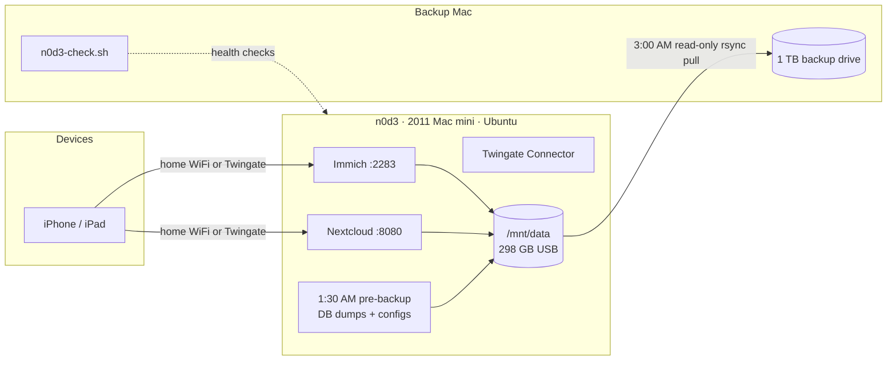
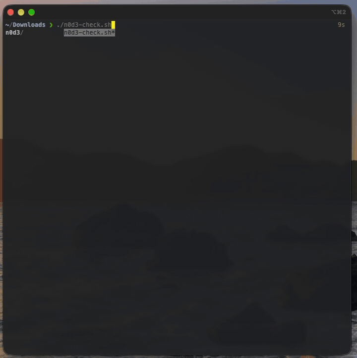

<p align="center">
  
</p>

<h1 align="center">n0d3 — The Digital Keeper</h1>

<p align="center">
  <em>A 2011 Mac mini, pulled out of a drawer and turned into a working headless home server.</em>
</p>

<p align="center">
  
  
  
  
  
  
</p>

---

**A fifteen-year-old Mac mini, reborn as the keeper of photos and files.** It runs photo backup, a private file cloud, and secure remote access with no open ports. A verified nightly backup goes to a second machine. Everything is administered over SSH with no monitor attached, on hardware that already existed.

> This repo is a working build log, not a tutorial: every step, every wall hit, and what's next. You're welcome to follow along.

## Contents

1. [Why](#why)
2. [At a Glance](#at-a-glance)
3. [Systems Check Script](#systems-check-script)
4. [How It Was Built](#how-it-was-built)
5. [Walls Hit (and How They Fell)](#walls-hit-and-how-they-fell)
6. [Repo Layout](#repo-layout)
7. [Reference Links](#reference-links)
8. [Roadmap and Status](#roadmap-and-status)

---

## Why

The machine is a **2011 Mac mini** that was doing nothing but collecting dust. Instead of buying hardware, the goal was to prove an old machine could still do real work, and to learn the full self-hosting stack hands-on. It's the low-risk pilot for a bigger NAS build later. Total hardware cost: **$0**.

---

## At a Glance

### Hardware

| Component | Detail |
|---|---|
| Server | 2011 Mac mini, Intel, hostname `n0d3` |
| Internal drive | 112 GB SSD: OS, app files, databases |
| Data drive | 298 GB external USB, ext4, mounted at `/mnt/data`: photos and files |
| Backup drive | 1 TB external, APFS (case-sensitive), attached to a **separate Mac** |
| Network | Wired gigabit ethernet, WiFi kept as automatic fallback |
| Access | Fully headless, administered over SSH |

### Software

| Layer | What it runs |
|---|---|
| **OS** | [Ubuntu Server 26.04 LTS](https://ubuntu.com/download/server) |
| **Containers** | [Docker + Docker Compose](https://docs.docker.com/engine/install/ubuntu/) |
| **Photo backup** | [Immich](https://immich.app/) |
| **File cloud** | [Nextcloud](https://hub.docker.com/_/nextcloud) + PostgreSQL 17 + Redis |
| **Remote access** | [Twingate](https://www.twingate.com/docs/connectors) zero-trust connector |
| **Backup transport** | rsync over SSH, locked down with [`rrsync`](https://man7.org/linux/man-pages/man1/rrsync.1.html) |
| **Scheduling** | [systemd timer](https://www.freedesktop.org/software/systemd/man/latest/systemd.timer.html) (server), [launchd](https://www.launchd.info/) (Mac) |
| **Networking** | [netplan](https://netplan.io/) / systemd-networkd |

### How it fits together



---

## Systems Check Script

<p align="center">
  
</p>

**[`scripts/n0d3-check.sh`](scripts/n0d3-check.sh)** runs on the Mac and checks the whole project in one pass: about 30 checks across five sections. It's **read-only** and changes nothing. Every warning or failure comes with the exact command to fix it.

| Section | What it checks |
|---|---|
| **1 · Backup Mac** | Drive mounted, ownership preserved, free space, Spotlight off, encryption, 3 AM job loaded, last backup result and age, rsync pinned, disk sleep, restart after power loss |
| **2 · Network** | Server reachable (with latency), Immich and Nextcloud answering, Nextcloud version and maintenance mode |
| **3 · n0d3 over SSH** | Uptime, load, memory, CPU temperature, data drive mounted read-write, disk space, unallocated LVM space, USB disconnects and ext4 errors in the last 24 h, pending updates, reboot required |
| **4 · Containers** | All 7 app containers up and healthy, plus the Twingate connector |
| **5 · Server pre-backup** | 1:30 AM timer active, last run's result |

**Built for fun too:** a typewriter boot sequence, scan bars, a spinner while it reaches the server, an animated health bar, an ending that matches the result (trophy, worried penguin, or "Houston, we have a problem"), and a random sysadmin quote.

```bash
chmod +x n0d3-check.sh
./n0d3-check.sh            # full show: colors + animations
./n0d3-check.sh --fast     # colors, no animations
./n0d3-check.sh --plain > report.txt   # clean text for saving
```

Exit codes: `0` all good, `1` warnings, `2` failures, so it can feed other automation. It's written for macOS's built-in bash 3.2. Edit the config block at the top for your server's address and login.

<details>
<summary><strong>View the full script</strong></summary>

```bash
#!/bin/bash
# ============================================================================
#  n0d3-check.sh  —  "The Digital Keeper" full systems check
#  Runs on the Mac. Checks the backup side locally and the server over SSH.
#
#  Usage:  ./n0d3-check.sh            (full show: colors + animations)
#          ./n0d3-check.sh --plain    (no colors, no animation; good for saving)
#          ./n0d3-check.sh --fast     (colors, but skip the animations)
#          ./n0d3-check.sh --help
#
#  Written for macOS's built-in bash 3.2. Read-only: it changes nothing.
# ============================================================================

# ---------------------------- CONFIG (edit me) ------------------------------
SERVER_HOST="192.168.1.50"           # change: your server's IP
SERVER_USER="youruser"               # change: your normal login on the server
BACKUP_VOL="/Volumes/n0d3-backup"    # the Toshiba
PULL_LOG="/var/log/n0d3-pull.log"    # written by n0d3-pull.sh
PULL_JOB="com.n0d3.pull"             # launchd label
IMMICH_PORT="2283"
NEXTCLOUD_PORT="8080"
MAX_BACKUP_AGE_H=26                  # warn if last good backup is older than this
EXPECTED_CONTAINERS="immich_server immich_postgres immich_redis nextcloud-app-1 nextcloud-db-1 nextcloud-redis-1 nextcloud-cron-1"
# ----------------------------------------------------------------------------

ANIM=1; COLOR=1
case "${1:-}" in
  --plain) ANIM=0; COLOR=0 ;;
  --fast)  ANIM=0 ;;
  -h|--help) sed -n '2,12p' "$0"; exit 0 ;;
esac
[ -t 1 ] || { ANIM=0; COLOR=0; }      # piped to a file? keep it clean
[ -n "${NO_COLOR:-}" ] && COLOR=0

if [ "$COLOR" = 1 ]; then
  R=$'\033[31m'; G=$'\033[32m'; Y=$'\033[33m'; B=$'\033[34m'; M=$'\033[35m'
  C=$'\033[36m'; W=$'\033[97m'; D=$'\033[2m'; BOLD=$'\033[1m'; X=$'\033[0m'
else
  R=; G=; Y=; B=; M=; C=; W=; D=; BOLD=; X=
fi

PASS=0; WARN=0; FAIL=0; FIXES=""
nap() { [ "$ANIM" = 1 ] && sleep "$1"; }

typeout() {                           # typewriter effect
  local s="$1" i
  if [ "$ANIM" = 1 ]; then
    for (( i=0; i<${#s}; i++ )); do printf '%s' "${s:$i:1}"; sleep 0.012; done
    printf '\n'
  else
    printf '%s\n' "$s"
  fi
}

ok()   { PASS=$((PASS+1)); printf "  ${G}[ OK ]${X}  %-30s ${D}%s${X}\n" "$1" "$2"; nap 0.05; }
warn() { WARN=$((WARN+1)); printf "  ${Y}[WARN]${X}  %-30s ${Y}%s${X}\n" "$1" "$2"
         [ -n "${3:-}" ] && FIXES="${FIXES}  ${Y}•${X} $1: $3\n"; nap 0.05; }
bad()  { FAIL=$((FAIL+1)); printf "  ${R}[FAIL]${X}  %-30s ${R}%s${X}\n" "$1" "$2"
         [ -n "${3:-}" ] && FIXES="${FIXES}  ${R}•${X} $1: $3\n"; nap 0.05; }
info() { printf "  ${C}[INFO]${X}  %-30s ${W}%s${X}\n" "$1" "$2"; nap 0.03; }

section() {
  printf "\n${M}${BOLD}┌─[ %s ]" "$1"
  local n=$(( 62 - ${#1} )) i; for (( i=0; i<n; i++ )); do printf '─'; done; printf "┐${X}\n"
  if [ "$ANIM" = 1 ]; then                # little scan bar
    printf "  ${D}scanning "
    for i in 1 2 3 4 5 6 7 8 9 10 11 12; do printf '▰'; sleep 0.02; done
    printf "\r\033[K${X}"
  fi
}

spin_while() {                        # spinner while a background PID runs
  local pid=$1 msg=$2 f='⠋⠙⠹⠸⠼⠴⠦⠧⠇⠏' i=0
  if [ "$ANIM" = 1 ]; then
    while kill -0 "$pid" 2>/dev/null; do
      printf "\r  ${C}%s${X} %s" "${f:$((i % 10)):1}" "$msg"; i=$((i+1)); sleep 0.08
    done
    printf "\r\033[K"
  fi
  wait "$pid"
}

# ============================== THE SHOW ====================================
[ "$ANIM" = 1 ] && clear
printf "${C}${BOLD}"
cat <<'ART'
          ___      _ _____
   _ __  / _ \  __| |___ /
  | '_ \| | | |/ _` | |_ \
  | | | | |_| | (_| |___) |
  |_| |_|\___/ \__,_|____/   d i g i t a l   k e e p e r
ART
printf "${X}${D}"
cat <<'ART'
        .--------------------------.
       /  ________________________ /|     2011 Mac mini
      /  /______________________ //|     "still on duty"
     /__________________________// |
     |  [o]   n0d3   ~~~~~~~~  |   /
     |__________________________|_/
ART
printf "${X}\n"

typeout "${D}> waking the keeper...${X}"
typeout "${D}> loading checklist: mac · server · storage · apps · backups${X}"
typeout "${D}> $(date '+%A %B %d %Y, %I:%M %p')${X}"

# Ask for sudo once, up front (needed to read launchd + backup folder details)
if ! sudo -n true 2>/dev/null; then
  printf "\n  ${Y}🔑 sudo needed once for read-only Mac checks:${X}\n"
  sudo -v || { printf "  ${R}No sudo — some Mac checks will be skipped.${X}\n"; }
fi

# ============================ 1. THE MAC ====================================
section "1 · BACKUP MAC"

if mount | grep -q " on ${BACKUP_VOL} ("; then
  ok "Backup drive mounted" "$BACKUP_VOL"
  if mount | grep " on ${BACKUP_VOL} (" | grep -q noowners; then
    bad "File ownership" "ignored (noowners)" "sudo diskutil enableOwnership $BACKUP_VOL"
  else
    ok "File ownership" "preserved"
  fi
  read -r vsize vused vavail vpct <<<"$(df -h "$BACKUP_VOL" | awk 'NR==2{print $2, $3, $4, $5}')"
  pct=${vpct%\%}
  if [ "${pct:-0}" -ge 90 ]; then bad "Backup drive space" "$vused used of $vsize ($vpct)" "free space or prune changed/"
  elif [ "${pct:-0}" -ge 75 ]; then warn "Backup drive space" "$vused used of $vsize ($vpct)" "keep an eye on growth"
  else ok "Backup drive space" "$vused used of $vsize, $vavail free"; fi
  if mdutil -s "$BACKUP_VOL" 2>/dev/null | grep -qi "disabled"; then ok "Spotlight indexing" "off"
  else warn "Spotlight indexing" "on" "sudo mdutil -i off $BACKUP_VOL"; fi
  if diskutil info "$BACKUP_VOL" 2>/dev/null | grep -q "FileVault:.*Yes"; then ok "Encryption" "on"
  else warn "Encryption" "off — backup holds .env secrets" "Finder → right-click drive → Encrypt"; fi
  if [ -d "$BACKUP_VOL/changed" ]; then
    vers=$(ls -1 "$BACKUP_VOL/changed" 2>/dev/null | wc -l | tr -d ' ')
    info "Versioned change folders" "$vers day(s) kept (30-day window)"
  fi
else
  bad "Backup drive mounted" "NOT mounted" "plug the Toshiba directly into the Mac"
fi

if sudo -n launchctl print "system/$PULL_JOB" >/dev/null 2>&1; then
  ok "Nightly pull job" "loaded (runs 3:00 AM)"
else
  bad "Nightly pull job" "not loaded" "sudo launchctl bootstrap system /Library/LaunchDaemons/$PULL_JOB.plist"
fi

if [ -r "$PULL_LOG" ]; then
  last=$(grep "finished rc=" "$PULL_LOG" | tail -1)
  rc=${last##*rc=}
  when=$(echo "$last" | sed -e 's/^=== //' -e 's/ finished.*//' | tr -s ' ')
  epoch=$(date -j -f "%a %b %d %T %Z %Y" "$when" +%s 2>/dev/null)
  if [ -n "$epoch" ]; then
    age_h=$(( ($(date +%s) - epoch) / 3600 ))
    agetxt="${age_h}h ago"
  else
    age_h=0; agetxt="$when"
  fi
  if [ "$rc" = "0" ] && [ "$age_h" -le "$MAX_BACKUP_AGE_H" ]; then
    ok "Last backup" "succeeded, $agetxt"
  elif [ "$rc" = "0" ]; then
    warn "Last backup" "succeeded but $agetxt" "is the Mac on at 3 AM? check pmset"
  else
    bad "Last backup" "rc=$rc, $agetxt" "sudo grep -E 'rsync:|ERROR' $PULL_LOG | tail"
  fi
else
  warn "Last backup" "no log yet" "has n0d3-pull.sh run?"
fi

if command -v brew >/dev/null 2>&1 && brew list --pinned 2>/dev/null | grep -qx rsync; then
  ok "Homebrew rsync" "pinned ($(/opt/homebrew/bin/rsync --version 2>/dev/null | head -1 | awk '{print $3}'))"
else
  warn "Homebrew rsync" "not pinned" "brew pin rsync (Full Disk Access is tied to its path)"
fi

pm=$(pmset -g 2>/dev/null)
ds=$(echo "$pm" | awk '$1=="disksleep"{print $2}')
ar=$(echo "$pm" | awk '$1=="autorestart"{print $2}')
[ "${ds:-1}" = "0" ] && ok "Disk sleep" "off" || warn "Disk sleep" "${ds:+on ($ds min)}${ds:-unknown}" "turn off 'Put hard disks to sleep'"
[ "${ar:-0}" = "1" ] && ok "Restart after power loss" "on" \
  || warn "Restart after power loss" "off" "Settings → Energy → Start up when power is connected"

# ============================ 2. NETWORK ====================================
section "2 · NETWORK"

if ping -c1 -t2 "$SERVER_HOST" >/dev/null 2>&1; then
  rtt=$(ping -c3 -t3 "$SERVER_HOST" 2>/dev/null | awk -F'/' '/round-trip/{printf "%.1f ms", $5}')
  ok "n0d3 reachable" "$SERVER_HOST ($rtt avg)"
else
  bad "n0d3 reachable" "no reply from $SERVER_HOST" "is the server on? ethernet plugged in?"
fi

imm=$(curl -s --max-time 5 "http://$SERVER_HOST:$IMMICH_PORT/api/server/ping" 2>/dev/null)
echo "$imm" | grep -q pong && ok "Immich web" "answering on :$IMMICH_PORT" \
  || bad "Immich web" "no answer on :$IMMICH_PORT" "cd ~/immich && docker compose ps (on n0d3)"

nc=$(curl -s --max-time 5 "http://$SERVER_HOST:$NEXTCLOUD_PORT/status.php" 2>/dev/null)
if echo "$nc" | grep -q '"installed":true'; then
  ncv=$(echo "$nc" | sed -n 's/.*"versionstring":"\([^"]*\)".*/\1/p')
  if echo "$nc" | grep -q '"maintenance":true'; then
    warn "Nextcloud web" "v$ncv — in maintenance mode" "occ maintenance:mode --off"
  else
    ok "Nextcloud web" "v$ncv answering on :$NEXTCLOUD_PORT"
  fi
else
  bad "Nextcloud web" "no answer on :$NEXTCLOUD_PORT" "cd ~/nextcloud && docker compose ps (on n0d3)"
fi

# ============================ 3. THE SERVER =================================
section "3 · n0d3 (over SSH)"

REMOTE=$(mktemp "${TMPDIR:-/tmp}/n0d3chk.XXXXXX")
remote_cmds() {
cat <<'EOS'
echo "HOST|$(hostname)"
echo "OS|$(. /etc/os-release; echo "$PRETTY_NAME")"
echo "UPTIME|$(uptime -p | sed 's/^up //')"
echo "LOAD|$(cut -d' ' -f1-3 /proc/loadavg)"
echo "MEM|$(free -m | awk '/^Mem:/{print $3" "$2}')"
for h in /sys/class/hwmon/hwmon*; do
  [ "$(cat $h/name 2>/dev/null)" = coretemp ] && echo "TEMP|$(( $(cat $h/temp1_input) / 1000 ))"
done
if findmnt -n /mnt/data >/dev/null 2>&1; then
  echo "DATAMNT|$(findmnt -n -o SOURCE,OPTIONS /mnt/data | awk '{print $1" "$2}')"
  echo "DFDATA|$(df -hP /mnt/data | awk 'NR==2{print $3" "$2" "$5}')"
else
  echo "DATAMNT|"
fi
echo "DFROOT|$(df -hP / | awk 'NR==2{print $3" "$2" "$5}')"
echo "LV|$(lsblk -bndo SIZE /dev/mapper/ubuntu--vg-ubuntu--lv 2>/dev/null) $(lsblk -bndo SIZE /dev/sda3 2>/dev/null)"
docker ps -a --format 'CT|{{.Names}}|{{.Status}}' 2>/dev/null || echo "DOCKER|down"
echo "TIMER|$(systemctl is-active n0d3-prebackup.timer 2>/dev/null)"
echo "PRERES|$(systemctl show n0d3-prebackup.service -p Result --value 2>/dev/null)"
echo "PRELAST|$(systemctl show n0d3-prebackup.service -p ExecMainExitTimestamp --value 2>/dev/null)"
echo "USBDROPS|$(journalctl -k --since '-24h' --no-pager 2>/dev/null | grep -c 'USB disconnect')"
echo "EXT4ERR|$(journalctl -k --since '-24h' --no-pager 2>/dev/null | grep -ci 'EXT4-fs error')"
echo "UPDATES|$(/usr/lib/update-notifier/apt-check 2>&1)"
[ -f /var/run/reboot-required ] && echo "REBOOT|yes" || echo "REBOOT|no"
EOS
}

( remote_cmds | ssh -o BatchMode=yes -o ConnectTimeout=6 "$SERVER_USER@$SERVER_HOST" 'bash -s' >"$REMOTE" 2>/dev/null ) &
spin_while $! "establishing uplink to n0d3..."
if [ ! -s "$REMOTE" ]; then
  printf "  ${Y}Key login unavailable — asking for your n0d3 password instead:${X}\n"
  remote_cmds | ssh -o ConnectTimeout=6 "$SERVER_USER@$SERVER_HOST" 'bash -s' >"$REMOTE" 2>/dev/null
fi

val() { grep "^$1|" "$REMOTE" | head -1 | cut -d'|' -f2-; }

if [ ! -s "$REMOTE" ]; then
  bad "SSH to n0d3" "could not log in" "ssh $SERVER_USER@$SERVER_HOST — does it work by hand?"
else
  ok "SSH to n0d3" "$(val HOST) · $(val OS)"
  info "Uptime" "$(val UPTIME)"
  info "Load (1/5/15 min)" "$(val LOAD)"
  read -r mu mt <<<"$(val MEM)"
  [ -n "$mt" ] && info "Memory" "${mu} MB used of ${mt} MB"
  t=$(val TEMP)
  if [ -n "$t" ]; then
    if   [ "$t" -ge 85 ]; then bad  "CPU temperature" "${t}°C — HOT" "check airflow; fan sensor is broken"
    elif [ "$t" -ge 70 ]; then warn "CPU temperature" "${t}°C — warm" "fan sensor is broken; watch this"
    else ok "CPU temperature" "${t}°C"; fi
  fi

  dm=$(val DATAMNT)
  if [ -n "$dm" ]; then
    set -- $dm
    case "$2" in
      rw,*) ok "Data drive (/mnt/data)" "mounted $1, read-write" ;;
      *)    bad "Data drive (/mnt/data)" "mounted READ-ONLY" "drive hit errors: stop apps, e2fsck, remount" ;;
    esac
    set -- $(val DFDATA)
    p=${3%\%}; [ "${p:-0}" -ge 85 ] && warn "Data drive space" "$1 of $2 ($3)" "nearly full" \
                                    || ok "Data drive space" "$1 of $2 used ($3)"
  else
    bad "Data drive (/mnt/data)" "NOT mounted" "stop apps, run e2fsck, then sudo mount -a"
  fi

  set -- $(val DFROOT); ok "System SSD (/)" "$1 of $2 used ($3)"
  set -- $(val LV)
  if [ -n "${1:-}" ] && [ -n "${2:-}" ] && [ "$1" -lt $(( $2 * 9 / 10 )) ]; then
    warn "Ubuntu volume size" "$(( $1 / 1073741824 ))G of $(( $2 / 1073741824 ))G allocated" \
         "sudo lvextend -r -l +100%FREE /dev/ubuntu-vg/ubuntu-lv"
  else
    ok "Ubuntu volume size" "using full disk"
  fi

  drops=$(val USBDROPS); errs=$(val EXT4ERR)
  [ "${drops:-0}" -eq 0 ] && ok "USB disconnects (24h)" "none" \
    || warn "USB disconnects (24h)" "$drops event(s)" "did someone hot-plug USB? check dmesg"
  [ "${errs:-0}" -eq 0 ] && ok "Filesystem errors (24h)" "none" \
    || bad "Filesystem errors (24h)" "$errs ext4 error(s)" "stop apps and run e2fsck"

  upd=$(val UPDATES); n_all=${upd%%;*}; n_sec=${upd##*;}
  if echo "$upd" | grep -q '^[0-9]*;[0-9]*$'; then
    if   [ "$n_sec" -gt 0 ]; then warn "OS updates" "$n_all pending ($n_sec security)" "sudo apt update && sudo apt upgrade"
    elif [ "$n_all" -gt 0 ]; then info "OS updates" "$n_all pending (none security)"
    else ok "OS updates" "up to date"; fi
  fi
  [ "$(val REBOOT)" = yes ] && warn "Reboot" "required after updates" "stop apps, then sudo reboot"

  # ------------------------------ containers --------------------------------
  section "4 · CONTAINERS"
  if grep -q "^DOCKER|down" "$REMOTE"; then
    bad "Docker" "not responding" "sudo systemctl status docker"
  else
    for c in $EXPECTED_CONTAINERS; do
      st=$(grep "^CT|$c|" "$REMOTE" | cut -d'|' -f3)
      case "$st" in
        Up*unhealthy*) bad  "$c" "$st" "docker logs $c --tail 30" ;;
        Up*)           ok   "$c" "$st" ;;
        "")            bad  "$c" "missing" "docker compose up -d in its folder" ;;
        *)             bad  "$c" "$st" "docker compose up -d in its folder" ;;
      esac
    done
    tg=$(grep "^CT|twingate-" "$REMOTE" | head -1)
    if [ -n "$tg" ]; then
      case "$(echo "$tg" | cut -d'|' -f3)" in
        Up*healthy*) ok "Twingate connector" "healthy" ;;
        Up*)         warn "Twingate connector" "up, health unknown" "check Twingate admin console" ;;
        *)           bad "Twingate connector" "down" "docker start $(echo "$tg" | cut -d'|' -f2)" ;;
      esac
    else
      bad "Twingate connector" "missing" "remote access is down"
    fi
  fi

  # ---------------------------- server backups ------------------------------
  section "5 · SERVER PRE-BACKUP"
  [ "$(val TIMER)" = active ] && ok "1:30 AM timer" "active" \
    || bad "1:30 AM timer" "$(val TIMER)" "sudo systemctl enable --now n0d3-prebackup.timer"
  pr=$(val PRERES); pl=$(val PRELAST)
  [ "$pr" = success ] && ok "Last pre-backup" "success · ${pl:-unknown}" \
    || bad "Last pre-backup" "${pr:-unknown}" "journalctl -u n0d3-prebackup.service -n 20"
fi
rm -f "$REMOTE"

# ============================ SCORECARD =====================================
TOTAL=$((PASS + WARN + FAIL)); SCORE=$(( TOTAL > 0 ? PASS * 100 / TOTAL : 0 ))
printf "\n${M}${BOLD}└"; for (( i=0; i<67; i++ )); do printf "─"; done; printf "┘${X}\n\n"

bar() { local n=$(( SCORE / 5 )) i; printf "  ${W}HEALTH ${X}["
  for (( i=0; i<20; i++ )); do
    if [ $i -lt $n ]; then printf "${G}█${X}"; else printf "${D}░${X}"; fi; nap 0.03
  done; printf "] ${BOLD}%d%%${X}\n" "$SCORE"; }
bar
printf "  ${G}%d passed${X}   ${Y}%d warnings${X}   ${R}%d failed${X}\n\n" "$PASS" "$WARN" "$FAIL"

if [ "$FAIL" -eq 0 ] && [ "$WARN" -eq 0 ]; then
  printf "${G}${BOLD}"; cat <<'ART'
        ___________
       '._==_==_=_.'      ALL SYSTEMS NOMINAL
       .-\:      /-.      The keeper keeps. Go to bed.
      | (|:.     |) |
       '-|:.     |-'
         \::.    /
          '::. .'
            ) (
          _.' '._
         '-------'
ART
elif [ "$FAIL" -eq 0 ]; then
  printf "${Y}${BOLD}"; cat <<'ART'
       .--.
      |o_o |      MOSTLY HEALTHY
      |:_/ |      A few things want attention when you have a minute.
     //   \ \
    (|     | )
   /'\_   _/`\
   \___)=(___/
ART
else
  printf "${R}${BOLD}"; cat <<'ART'
      _____
     /     \      HOUSTON, WE HAVE A PROBLEM
    | () () |     Something needs fixing before tonight's backup.
     \  ^  /
      |||||
      |||||
ART
fi
printf "${X}"

if [ -n "$FIXES" ]; then
  printf "\n  ${W}${BOLD}Suggested fixes:${X}\n"
  printf "%b" "$FIXES"
fi

QUOTES=(
  "There are two kinds of people: those who back up, and those who will."
  "A backup you've never restored from is only a hope."
  "Old hardware never dies. It just gets a Linux install."
  "It's not a bug, it's a 15-year-old feature."
  "Uptime is a lifestyle."
  "sudo make me a sandwich."
  "Have you tried turning it off and on again? (Don't. It's running backups.)"
)
q=${QUOTES[$(( RANDOM % ${#QUOTES[@]} ))]}
printf "\n  ${D}❝ %s ❞${X}\n\n" "$q"

[ "$FAIL" -gt 0 ] && exit 2
[ "$WARN" -gt 0 ] && exit 1
exit 0
```

</details>

---

## How It Was Built

<details open>
<summary><strong>Steps 1–7 · Base server</strong></summary>

#### 1. Install the OS
Clean install of **Ubuntu Server LTS** from a USB stick, with **OpenSSH** enabled during setup so the machine could be reached once headless.

#### 2. Get it on the network
The WiFi is a **hidden network**, which the installer couldn't see. Configured it by hand in netplan with the `hidden: true` flag. The machine runs `systemd-networkd`, so the usual `NetworkManager` tools weren't available.

#### 3. Go headless and hardwire
Connected **wired ethernet** and added an `ethernets` block to netplan, keeping WiFi as an automatic fallback so a headless box can never be fully locked out. The address is pinned with a **static DHCP reservation**.

#### 4. Install Docker
Official install script, verified with `hello-world`. Added the user to the `docker` group.

#### 5. Set up storage
Wiped an old Mac-formatted USB drive, formatted it **ext4**, mounted it at `/mnt/data`, and added it to `/etc/fstab` with `nofail` so a missing drive can never hang the boot.

#### 6. Deploy Immich (photo backup)
Docker Compose, storage on the external drive, custom database password. The phone app's server URL needs an `/api` suffix, which is a common gotcha.

#### 7. Deploy Twingate (secure remote access)
Defined the home subnet as a resource and ran the **Connector** as a Docker container. The server is reachable from anywhere with **no ports opened to the internet**.

</details>

<details open>
<summary><strong>Steps 8–9 · Nextcloud</strong></summary>

#### 8. Deploy Nextcloud (private file cloud)
A four-container stack, split across drives for speed and capacity. Full file: [`config/nextcloud-compose.yaml`](config/nextcloud-compose.yaml).

| Container | Role | Lives on |
|---|---|---|
| `app` | Nextcloud (`nextcloud:stable-apache`), port 8080 | App on SSD, user files on `/mnt/data/nextcloud` |
| `db` | PostgreSQL 17 | SSD |
| `redis` | Cache and file locking | Memory |
| `cron` | Background jobs | Shares the app's volumes |

Secrets live in a `.env` file locked to `chmod 600`, and the first-install admin password was **removed from disk** once the install finished. Nextcloud runs as user ID 33, so its data folder was handed over first:

```bash
sudo mkdir -p /mnt/data/nextcloud
sudo chown 33:33 /mnt/data/nextcloud
sudo chmod 750 /mnt/data/nextcloud
```

#### 9. Harden Nextcloud
Post-install tuning with [`occ`](https://docs.nextcloud.com/server/latest/admin_manual/occ_command.html), Nextcloud's admin tool:

```bash
alias occ='docker compose exec -u www-data app php occ'
occ background:cron                                   # jobs run by the cron container
occ config:system:set default_phone_region --value="US"
occ config:system:set maintenance_window_start --type=integer --value=7
occ db:add-missing-indices
occ maintenance:repair --include-expensive
occ app:disable app_api                               # unused AI apps = less attack surface
```

- **Two-factor authentication** (TOTP) enforced for every account, with backup codes saved.
- **A separate non-admin daily account.** The admin account is only for administration.
- **Verified the files land on the external drive**, not the SSD:

<p align="center"></p>

| Security warning | Decision |
|---|---|
| No HTTPS / HSTS | Accepted for the pilot: LAN-only, and Twingate encrypts remote traffic |
| Email server not set | Accepted: only needed for password-reset emails |
| AppAPI deploy daemon | Fixed: app disabled |
| Server ID | Fixed |
| 2FA not enforced | Fixed |

</details>

<details open>
<summary><strong>Steps 10–11 · Backups and restore test</strong></summary>

#### 10. Nightly backup to a second machine
The original plan was a second USB drive on the server, which **failed** (see [Walls Hit](#walls-hit-and-how-they-fell)). The backup drive moved to a separate Mac instead, which turned out to be a better design. **The Mac pulls from the server; the server never has access to the backup.**

| Time | Where | What | Files |
|---|---|---|---|
| 1:30 AM | Server | Dump both databases and configs to `/mnt/data/_server-backup` | [`n0d3-prebackup.sh`](scripts/n0d3-prebackup.sh), [service](config/n0d3-prebackup.service), [timer](config/n0d3-prebackup.timer) |
| 3:00 AM | Mac | Pull everything to the backup drive, keeping changed or deleted files for 30 days | [`n0d3-pull.sh`](scripts/n0d3-pull.sh), [launchd plist](config/com.n0d3.pull.plist) |

**Locked-down access:** a dedicated `nbackup` user whose SSH key can run exactly one thing: read-only `rrsync` confined to `/mnt/data`. No shell, no writing, nothing outside that folder. See [`sudoers-nbackup`](config/sudoers-nbackup) and [`authorized_keys.example`](config/authorized_keys.example).

```
# nbackup's authorized_keys (one line)
restrict,command="sudo /usr/bin/rrsync -ro /mnt/data" ssh-ed25519 AAAA... n0d3-backup
```

Trying to log in with that key is refused, which is exactly the point:

```
$ ssh -i n0d3_backup nbackup@<server-ip>
PTY allocation request failed on channel 0
/usr/bin/rrsync error: Not invoked via sshd
Connection to <server-ip> closed.
```

**Safety guards in the pull script:**
- **Guard 1:** the backup drive must be a real mount, not just a leftover folder with that name.
- **Guard 2:** the server's `last-run.txt` must be fetchable. If the data drive has dropped, the script stops instead of mirroring an empty folder over a good backup.
- **Versioning:** anything changed or deleted on the server is moved to `changed/<date>/` and kept for 30 days.

```bash
mount | grep -q " on $DEST (" && [ -d "$DEST/data" ] || { echo "ERROR: backup drive not mounted"; exit 1; }

$RSYNC -a --numeric-ids --delete \
  --backup --backup-dir="$DEST/changed/$STAMP" \
  -e "ssh -i $KEY" "$SERVER:/" "$DEST/data/"
```

First full copy: **36,508 items, ~65 GB, about 2 h 17 min**, capped by the 2011 mini's USB 2.0. Nightly runs after that take **under a minute**:

```
=== Sun Oct 18 21:12:00 EDT 2026 start
Server pre-backup ran: Sun Oct 18 05:25:27 PM EDT 2026
=== Sun Oct 18 21:12:15 EDT 2026 finished rc=0
```

The backup Mac never sleeps and never spins down its disks:

<p align="center"></p>

#### 11. Prove the restore works
A backup you've never restored from is only a hope. All three checks passed:

```bash
# Same video file, fingerprinted on both machines
4064fa8561ec4bdbf05fe387d21ef6bd9ef37dec85ba4116b3e77b53c86ac016  (server)
4064fa8561ec4bdbf05fe387d21ef6bd9ef37dec85ba4116b3e77b53c86ac016  (backup)

$ sudo gzip -t .../_server-backup/immich-db.sql.gz && echo "Immich dump OK"
Immich dump OK

$ sudo head -c 5 .../_server-backup/nextcloud-db.dump
PGDMP                     # valid PostgreSQL dump signature
```

A Nextcloud document was also copied out of the backup and opened normally.

</details>

---

## Walls Hit (and How They Fell)

| # | Problem | Cause | Fix |
|---|---|---|---|
| 1 | Hidden WiFi wouldn't connect | Hidden networks don't broadcast their name | `hidden: true` in netplan |
| 2 | Docker install: "could not get lock" | `unattended-upgrades` held the package lock | Waited it out, then re-ran |
| 3 | Immich ML container crash-looped | 2011 CPU lacks the `x86-64-v2` instructions NumPy needs | Disabled just that service with a Compose `profiles` tag |
| 4 | Nextcloud files "missing" | The account ID contained a space | List the parent folder first, then quote the path |
| 5 | Second drive knocked the first offline | Hot-plug power transient on the 2011 mini's USB | `e2fsck`, remount, move backup drive to the Mac. Rule: never hot-plug USB on `n0d3` |
| 6 | `rrsync error: invalid rsync-command` | macOS 15.4 [replaced rsync with openrsync](https://heise.de/-10350663) | [Homebrew rsync](https://formulae.brew.sh/formula/rsync), called by full path |
| 7 | Dry run "succeeded" on an empty folder | Data drive had dropped; rrsync served the empty mount point | Both scripts now refuse to run without the right drive mounted |
| 8 | `chmod …/*`: "No such file" | Your shell expands `*` before `sudo`, and can't see a root-only folder | `sudo sh -c 'chmod 600 /path/*'` |
| 9 | `rename … No such file or directory` | Two rsync runs writing to one destination | Never overlap runs |
| 10 | Backup drive vanished mid-run | Drive was on a USB hub and disconnected | Plugged directly into the Mac, Spotlight off, stricter mount guard |
| 11 | File owners not preserved | Volume mounted with `noowners` | `sudo diskutil enableOwnership /Volumes/n0d3-backup` |
| 12 | `Operation not permitted`, only when scheduled | macOS privacy controls (TCC) block background jobs from external drives | Full Disk Access for `/bin/bash` and rsync, then `brew pin rsync` |

<details>
<summary><strong>Details and evidence</strong></summary>

#### 3 · Immich machine learning vs. a 2011 CPU
> `NumPy was built with baseline optimizations (X86_V2) but your machine doesn't support (X86_V2)`

A hardware-age limit, not a configuration problem. Photo backup works perfectly; only smart search is lost.

#### 4 · Nextcloud files "missing"
<p align="center"></p>

The account ID wasn't what was expected: the display name had been typed into the username field, so it contained a space. Paths with spaces must be quoted.

#### 5 · The USB power problem, from the kernel log
Plugging in the second drive:
```
[20:15:14] Buffer I/O error on dev sdb1, logical block 38830080, lost sync page write
[20:15:15] EXT4-fs (sdb1): Remounting filesystem read-only
[20:15:16] sd 3:0:0:0: [sdc] Attached SCSI disk          <- same drive, new name, not mounted
```
Unplugging it again:
```
[20:36:08] usb 3-4: USB disconnect, device number 5      <- data drive
[20:36:09] usb 2-4: USB disconnect, device number 2      <- backup drive unplugged, same second
```
Recovery: stop the containers, then `sudo e2fsck -f -p /dev/disk/by-uuid/<uuid>`, `sudo mount -a`, and confirm the state is `clean`. Nothing was lost.

#### 11 · Ownership silently ignored
<p align="center"></p>

`Owners enabled: No` means macOS ignores file owners on that drive, so the backup would lose who owns what. One command fixes it, and the next rsync run corrected every owner in place.

</details>

---

## Repo Layout

```
.
├── README.md
├── digital-keeper.jpg
├── media/
│   └── n0d3-check-demo.gif         # the looping demo above
├── images/                         # screenshots (sensitive details redacted)
├── scripts/
│   ├── n0d3-check.sh               # Mac: full systems check
│   ├── n0d3-prebackup.sh           # server: 1:30 AM DB dumps + configs
│   └── n0d3-pull.sh                # Mac: 3:00 AM read-only pull
└── config/
    ├── nextcloud-compose.yaml      # Nextcloud stack
    ├── n0d3-prebackup.service      # systemd unit (server)
    ├── n0d3-prebackup.timer        # systemd timer (server)
    ├── com.n0d3.pull.plist         # launchd job (Mac)
    ├── sudoers-nbackup             # one-command sudo rule
    └── authorized_keys.example     # restricted backup key
```

Addresses, usernames, and key paths in these files are **placeholders**. Replace them with your own before use.

---

## Reference Links

| Topic | Link |
|---|---|
| Ubuntu Server download | <https://ubuntu.com/download/server> |
| Docker Engine on Ubuntu | <https://docs.docker.com/engine/install/ubuntu/> |
| Immich backup and restore | <https://docs.immich.app/administration/backup-and-restore> |
| Nextcloud Docker image | <https://hub.docker.com/_/nextcloud> |
| Nextcloud `occ` command | <https://docs.nextcloud.com/server/latest/admin_manual/occ_command.html> |
| Nextcloud admin manual (PDF) | <https://docs.nextcloud.com/server/latest/Nextcloud_Server_Administration_Manual.pdf> |
| Twingate Connector with Docker Compose | <https://www.twingate.com/docs/deploy-connector-with-docker-compose> |
| `rrsync` man page | <https://man7.org/linux/man-pages/man1/rrsync.1.html> |
| Homebrew rsync | <https://formulae.brew.sh/formula/rsync> |
| macOS replaces rsync with openrsync | <https://heise.de/-10350663> |
| systemd timers | <https://www.freedesktop.org/software/systemd/man/latest/systemd.timer.html> |
| launchd | <https://www.launchd.info/> |
| `e2fsck` | <https://man7.org/linux/man-pages/man8/e2fsck.8.html> |
| netplan | <https://netplan.io/> |

---

## Roadmap and Status

| Service | State |
|---|---|
| Ubuntu Server | ✅ running |
| Docker | ✅ running |
| Storage (`/mnt/data`) | ✅ mounted, auto-mounts on boot |
| Immich | ✅ running, backing up |
| Immich ML (smart search) | ⚠️ disabled (CPU too old) |
| Nextcloud | ✅ running, 2FA enforced |
| Twingate Connector | ✅ deployed, healthy |
| Nightly backup | ✅ automated, restore verified |
| Systems check script | ✅ running on the Mac |

**Next up**
- [x] Twingate client on iPhone
- [x] Deploy Nextcloud
- [x] Nightly backup to a second machine, with a verified restore
- [x] One-command systems check
- [ ] Test remote access off-network (cellular)
- [ ] Expand the Ubuntu volume (using 54 of 108 GB)
- [ ] Alert on a missed or failed backup night
- [ ] Encrypt the backup drive (it holds `.env` secrets)
- [ ] Longer term: a proper NAS with **mirrored drives** and an **off-site backup**

---

<p align="center"><em>Built on hardware that was headed for a landfill. Still useful, fifteen years later.</em></p>
