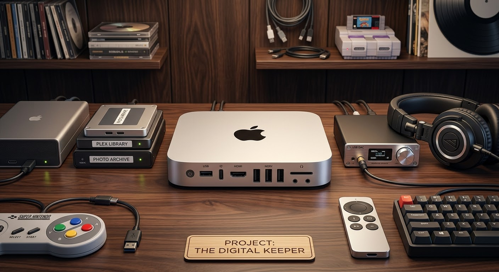

  

<h1 align="center">n0d3 — The Digital Keeper</h1>

<em>A 2011 Mac mini, pulled out of a drawer and turned into a working headless home server.</em>

---

**A fifteen-year-old Mac mini — reborn as the keeper of photos, files, and media.** It runs photo backup, secure remote access, and a container stack, administered entirely over SSH with no monitor attached. No new hardware was bought. An idle machine was given a second life.

> This repo documents the full build: every step taken, every wall hit, and what's next. It's a working log, not a tutorial — but you're welcome to follow along.

---

## Why

The machine is a **2011 Mac mini** that was doing nothing but collecting dust. Instead of buying hardware, the goal was to prove an old machine could still do real work — and to learn the full self-hosting stack hands-on in the process. Everything here was built for a few dollars (the software is all free) on hardware that already existed.

---

## The Stack

| Layer | What it runs | Link |
|---|---|---|
| **OS** | Ubuntu Server (LTS) | <https://ubuntu.com/server> |
| **Containers** | Docker + Docker Compose | <https://www.docker.com/> |
| **Photo backup** | Immich | <https://immich.app/> |
| **Remote access** | Twingate (zero-trust) | <https://www.twingate.com/> |
| **Networking** | netplan / systemd-networkd | <https://netplan.io/> |

**Planned next:** Nextcloud (<https://nextcloud.com/>) for file sync, plus a second drive for backups.

---

## The Hardware

| Component | Detail |
|---|---|
| Machine | 2011 Mac mini, Intel |
| Internal drive | 112 GB SSD (OWC) — runs the OS |
| Storage drive | 298 GB external USB (reformatted to ext4) |
| Network | Wired gigabit ethernet, with WiFi configured as automatic fallback |
| Access | Fully headless — no monitor or keyboard, administered over SSH |

---

## How It Was Built

Each step below was done from scratch, start to finish.

### 1. Install the OS
Clean install of **Ubuntu Server LTS** from a USB stick, with **OpenSSH** enabled during setup so the machine could be reached remotely once headless.

### 2. Get it on the network
The tricky part: the WiFi is a **hidden network**, which the installer couldn't see. Configured it by hand in a netplan file — including the `hidden: true` flag that hidden networks require — and brought the interface up from the command line. (The machine runs on `systemd-networkd`, so none of the usual `NetworkManager` tools were available; everything was done through netplan directly.)

### 3. Go headless and hardwire
Moved the mini to its permanent home, connected **wired ethernet**, and added an `ethernets` block to netplan — while keeping WiFi configured as an automatic fallback so a headless box can never be fully locked out. From here on, all work was done over **SSH** from a separate computer. The wired address was pinned to a **static DHCP reservation** so it never changes.

### 4. Install Docker
Installed **Docker** via the official script and verified it with the `hello-world` container. Added the user to the `docker` group so containers can be managed without `sudo`.

### 5. Set up storage
Took an old external USB drive (formerly Mac-formatted APFS, which Linux can't read), confirmed it was empty, wiped it, and gave it a fresh **ext4** filesystem. Mounted it at `/mnt/data` and added it to `/etc/fstab` with the `nofail` option — so a missing drive can never hang the boot — then tested the entry before trusting it.

### 6. Deploy Immich (photo backup)
Stood up **Immich** with Docker Compose, pointed its storage at the external drive, set a database password, and created the admin account. Connected the phone app (endpoint URL needs an `/api` suffix — a common gotcha) and started backing up photos to self-hosted storage.

### 7. Deploy Twingate (secure remote access)
Set up a free **Twingate** zero-trust network, defined the home subnet as a protected resource, and deployed the **Connector** as a Docker container on the mini — the piece that makes the server reachable securely from anywhere, without exposing any ports to the internet.

---

## Walls Hit (and How They Fell)

Real builds have problems. Here are the ones worth remembering.

### Hidden WiFi wouldn't connect
The interface kept coming up `DOWN` with no IP, even though the config looked right. **Cause:** the network is hidden and wasn't broadcasting its name. **Fix:** added `hidden: true` to the netplan WiFi block. Connected immediately.

### Docker install blocked mid-run
The installer failed with a "could not get lock" error. **Cause:** Ubuntu's automatic background updater (`unattended-upgrades`) was holding the package lock. **Fix:** waited for it to finish, then re-ran — no force, no fighting it.

### Immich's machine-learning container crash-looped
One container restarted endlessly. The logs told the real story:

> `NumPy was built with baseline optimizations (X86_V2) but your machine doesn't support (X86_V2)`

**Cause:** the 2011 CPU predates the `x86-64-v2` instruction tier the modern ML code requires. This is a **hardware-age limit** — not fixable by configuration. **Fix:** cleanly disabled just that one service via a Compose `profiles` tag, preserving the config for future hardware. Photo backup and everything else run perfectly without it; only smart search (face/object recognition) is unavailable. Knowing when a wall is the silicon and not the setup is half the job.

---

## Roadmap

- [ ] Install the **Twingate client** on phone/laptop and verify remote access off-network
- [ ] Add a **second USB drive** as a backup target, with a nightly copy job
- [ ] Deploy **Nextcloud** for file sync (private Dropbox/iCloud alternative)
- [ ] Longer term: migrate to a proper NAS with **mirrored drives** and an **off-site backup**

---

## Status

| Service | State |
|---|---|
| Ubuntu Server | ✅ running |
| Docker | ✅ running |
| Storage (`/mnt/data`) | ✅ mounted, auto-mounts on boot |
| Immich | ✅ running, backing up |
| Twingate Connector | ✅ deployed, healthy |
| Immich ML (smart search) | ⚠️ disabled (CPU too old) |
| Nextcloud | ⬜ planned |

---

<em>Built on hardware that was headed for a landfill. Still useful, fifteen years later.</em>

