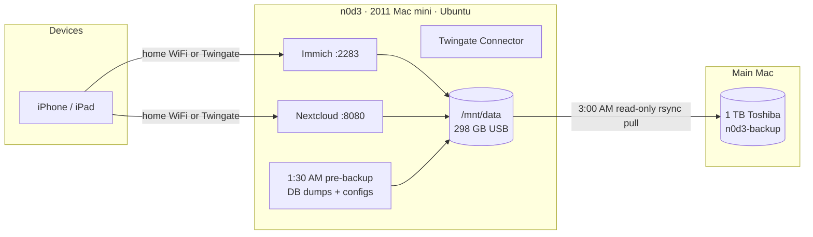
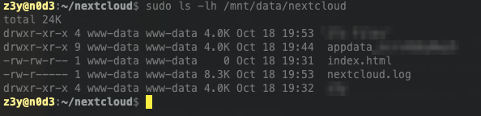
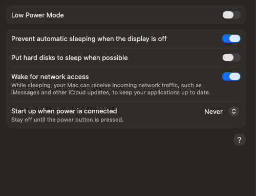
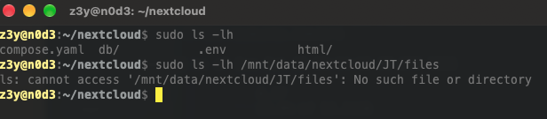
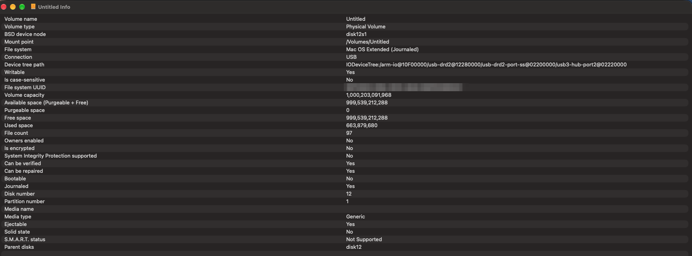

<p align="center">
  
</p>

<h1 align="center">n0d3 — The Digital Keeper</h1>

<p align="center"><em>A 2011 Mac mini, pulled out of a drawer and turned into a working headless home server.</em></p>

---

**A fifteen-year-old Mac mini, reborn as the keeper of photos and files.** It runs photo backup, a private file cloud, secure remote access, and a verified nightly backup to a second machine. It's administered entirely over SSH with no monitor attached. No new hardware was bought; an idle machine was given a second life.

> This repo documents the full build: every step taken, every wall hit, and what's next. It's a working log, not a tutorial, but you're welcome to follow along.

---

## Why

The machine is a **2011 Mac mini** that was doing nothing but collecting dust. Instead of buying hardware, the goal was to prove an old machine could still do real work, and to learn the full self-hosting stack hands-on in the process. It's the low-risk pilot for a bigger NAS build later. Everything here was built on hardware that already existed, and the software is all free.

---

## The Stack

| Layer | What it runs | Link |
|---|---|---|
| **OS** | Ubuntu Server 26.04 LTS | <https://ubuntu.com/download/server> |
| **Containers** | Docker + Docker Compose | <https://docs.docker.com/engine/install/ubuntu/> |
| **Photo backup** | Immich | <https://immich.app/> |
| **File cloud** | Nextcloud (official image) + PostgreSQL 17 + Redis | <https://hub.docker.com/_/nextcloud> |
| **Remote access** | Twingate (zero-trust) | <https://www.twingate.com/docs/connectors> |
| **Backup transport** | rsync over SSH, locked down with `rrsync` | <https://man7.org/linux/man-pages/man1/rrsync.1.html> |
| **Scheduling** | systemd timer (server), launchd (Mac) | <https://www.freedesktop.org/software/systemd/man/latest/systemd.timer.html> |
| **Networking** | netplan / systemd-networkd | <https://netplan.io/> |

---

## The Hardware

| Component | Detail |
|---|---|
| Server | 2011 Mac mini, Intel, hostname `n0d3` |
| Internal drive | 112 GB SSD (OWC): OS, app files, and databases |
| Data drive | 298 GB external USB, ext4, mounted at `/mnt/data`: photos and files |
| Backup drive | 1 TB Toshiba, APFS (case-sensitive), attached to a **separate Mac** |
| Network | Wired gigabit ethernet, with WiFi configured as automatic fallback |
| Access | Fully headless: no monitor or keyboard, administered over SSH |

---

## How It Fits Together



---

## How It Was Built

### 1. Install the OS
Clean install of **Ubuntu Server LTS** from a USB stick, with **OpenSSH** enabled during setup so the machine could be reached remotely once headless.

### 2. Get it on the network
The WiFi is a **hidden network**, which the installer couldn't see. Configured it by hand in netplan, including the `hidden: true` flag hidden networks require. The machine runs `systemd-networkd`, so none of the usual `NetworkManager` tools were available.

### 3. Go headless and hardwire
Moved the mini to its permanent home, connected **wired ethernet**, and added an `ethernets` block to netplan. WiFi stays configured as an automatic fallback, so a headless box can never be fully locked out. The wired address is pinned with a **static DHCP reservation**.

### 4. Install Docker
Installed **Docker** via the official script and verified it with `hello-world`. Added the user to the `docker` group so containers can be managed without `sudo`.

### 5. Set up storage
Wiped an old Mac-formatted USB drive and gave it a fresh **ext4** filesystem. Mounted it at `/mnt/data` and added it to `/etc/fstab` with `nofail`, so a missing drive can never hang the boot.

### 6. Deploy Immich (photo backup)
Stood up **Immich** with Docker Compose, storage on the external drive, custom database password, admin account. The phone app's server URL needs an `/api` suffix, which is a common gotcha.

### 7. Deploy Twingate (secure remote access)
Created a free **Twingate** network, defined the home subnet as a resource, and deployed the **Connector** as a Docker container. The server is reachable from anywhere with **no ports opened to the internet**. The iPhone client is installed.

### 8. Deploy Nextcloud (private file cloud)
A four-container Compose stack, split across drives for speed and capacity:

| Container | Role | Lives on |
|---|---|---|
| `app` | Nextcloud (`nextcloud:stable-apache`), port 8080 | App files on SSD, user files on `/mnt/data/nextcloud` |
| `db` | PostgreSQL 17 | SSD |
| `redis` | Cache and file locking | Memory |
| `cron` | Nextcloud background jobs | (shares the app's volumes) |

```yaml
  app:
    image: nextcloud:stable-apache
    ports:
      - "8080:80"
    volumes:
      - ./html:/var/www/html                    # app + config on the SSD
      - /mnt/data/nextcloud:/var/www/html/data  # user files on the USB drive
    environment:
      POSTGRES_HOST: db
      REDIS_HOST: redis
      NEXTCLOUD_TRUSTED_DOMAINS: 192.168.4.203 n0d3
```

Secrets live in a `.env` file locked to `chmod 600`. The first-install admin password was **removed from disk** once the install finished. Nextcloud runs as user ID 33, so its data folder was handed over first:

```bash
sudo mkdir -p /mnt/data/nextcloud
sudo chown 33:33 /mnt/data/nextcloud
sudo chmod 750 /mnt/data/nextcloud
```

### 9. Harden Nextcloud
Post-install tuning with Nextcloud's admin tool, [`occ`](https://docs.nextcloud.com/server/latest/admin_manual/occ_command.html):

```bash
alias occ='docker compose exec -u www-data app php occ'
occ background:cron                                   # background jobs via the cron container
occ config:system:set default_phone_region --value="US"
occ config:system:set maintenance_window_start --type=integer --value=7
occ db:add-missing-indices
occ maintenance:repair --include-expensive
occ app:disable app_api                               # AI ex-apps: unused, less attack surface
```

Then:
- **Two-factor authentication** (TOTP) enforced for every account, with backup codes saved.
- **A separate non-admin daily account.** The admin account is only used for administration.
- **Verified the files land on the external drive**, not the SSD:

<p align="center"></p>

Security check results, triaged:

| Warning | Decision |
|---|---|
| No HTTPS / HSTS | Accepted for the pilot: LAN-only, and Twingate encrypts remote traffic |
| Email server not set | Accepted: only needed for password-reset emails |
| AppAPI deploy daemon | Fixed: app disabled |
| Server ID | Fixed |
| 2FA not enforced | Fixed |

### 10. Nightly backup to a second machine
The original plan was a second USB drive on the server. That **failed**; see *Walls Hit* below. So the backup drive moved to a separate Mac, which turned out to be a better design. **The Mac pulls from the server; the server never has access to the backup.**

**Step 1, on the server (1:30 AM, systemd timer):** a script dumps both databases and the config files onto the data drive, so one copy captures everything needed for a restore.

```bash
#!/bin/bash
set -euo pipefail
umask 077
DEST=/mnt/data/_server-backup

# Refuse to run if the data drive isn't mounted
mountpoint -q /mnt/data || { echo "ERROR: /mnt/data not mounted" >&2; exit 1; }
mkdir -p "$DEST"

# Nextcloud database (custom-format dump)
docker exec nextcloud-db-1 pg_dump -U nextcloud -Fc nextcloud > "$DEST/nextcloud-db.dump.tmp"
mv "$DEST/nextcloud-db.dump.tmp" "$DEST/nextcloud-db.dump"

# Immich database (official method)
docker exec immich_postgres pg_dumpall --clean --if-exists --username=postgres | gzip > "$DEST/immich-db.sql.gz.tmp"
mv "$DEST/immich-db.sql.gz.tmp" "$DEST/immich-db.sql.gz"

# Compose files, .env secrets, Nextcloud config
tar -czf "$DEST/configs.tar.gz.tmp" -C /home/z3y \
  immich/docker-compose.yml immich/.env \
  nextcloud/compose.yaml nextcloud/.env nextcloud/html/config
mv "$DEST/configs.tar.gz.tmp" "$DEST/configs.tar.gz"

date > "$DEST/last-run.txt"
```

Each file is written under a temporary name first and renamed only when complete, so a half-written dump never replaces a good one.

**Step 2, locked-down access:** a dedicated `nbackup` user whose SSH key can run exactly one thing, read-only `rrsync` confined to `/mnt/data`. No shell, no writing, nothing outside that folder.

```
# /etc/sudoers.d/nbackup
Defaults!/usr/bin/rrsync env_keep += "SSH_ORIGINAL_COMMAND"
nbackup ALL=(root) NOPASSWD: /usr/bin/rrsync -ro /mnt/data

# nbackup's authorized_keys (one line)
restrict,command="sudo /usr/bin/rrsync -ro /mnt/data" ssh-ed25519 AAAA... n0d3-backup
```

Trying to log in with that key gets refused, which is exactly the point:

```
$ ssh -i n0d3_backup nbackup@192.168.4.203
PTY allocation request failed on channel 0
/usr/bin/rrsync error: Not invoked via sshd
Connection to 192.168.4.203 closed.
```

**Step 3, on the Mac (3:00 AM, launchd):** pull everything to the Toshiba. The script includes two guards and versioning:
- **Guard 1:** the backup drive must be a real mount, not just a folder with that name.
- **Guard 2:** the server's `last-run.txt` must be fetchable. If the data drive has dropped, the script stops instead of mirroring an empty folder over the backup.
- **Versioning:** files that change or are deleted on the server are moved to `changed/<date>/` and kept for 30 days.

```bash
mount | grep -q " on $DEST (" && [ -d "$DEST/data" ] || { echo "ERROR: backup drive not mounted"; exit 1; }

$RSYNC -e "ssh -i $KEY" "$SERVER:/_server-backup/last-run.txt" /tmp/n0d3-lastrun.txt \
  || { echo "ERROR: server data drive not mounted"; exit 1; }

$RSYNC -a --numeric-ids --delete \
  --backup --backup-dir="$DEST/changed/$STAMP" \
  -e "ssh -i $KEY" "$SERVER:/" "$DEST/data/"
```

First full copy: **36,508 items, ~65 GB, about 2 h 17 min** (capped by the 2011 mini's USB 2.0). Nightly runs after that: **under a minute**.

```
=== Sun Oct 18 21:12:00 EDT 2026 start
Server pre-backup ran: Sun Oct 18 05:25:27 PM EDT 2026
=== Sun Oct 18 21:12:15 EDT 2026 finished rc=0
```

The Mac is set to never sleep and never spin down disks:

<p align="center"></p>

### 11. Prove the restore works
A backup you've never restored from is only a hope. All three checks passed:

```bash
# Same video, fingerprinted on both machines: identical
4064fa8561ec4bdbf05fe387d21ef6bd9ef37dec85ba4116b3e77b53c86ac016  (server)
4064fa8561ec4bdbf05fe387d21ef6bd9ef37dec85ba4116b3e77b53c86ac016  (backup)

$ sudo gzip -t .../_server-backup/immich-db.sql.gz && echo "Immich dump OK"
Immich dump OK
$ sudo head -c 5 .../_server-backup/nextcloud-db.dump
PGDMP                     # valid PostgreSQL dump signature
```

A Nextcloud document was also copied out of the backup and opened normally.

---

## Walls Hit (and How They Fell)

### Hidden WiFi wouldn't connect
The interface stayed `DOWN`. **Cause:** a hidden network doesn't broadcast its name. **Fix:** `hidden: true` in netplan.

### Docker install blocked mid-run
"Could not get lock." **Cause:** `unattended-upgrades` held the package lock. **Fix:** waited for it to finish, then re-ran.

### Immich's machine-learning container crash-looped
> `NumPy was built with baseline optimizations (X86_V2) but your machine doesn't support (X86_V2)`

**Cause:** the 2011 CPU lacks the instruction set modern ML builds require, which is a hardware-age limit. **Fix:** disabled just that service with a Compose `profiles` tag. Only smart search is lost.

### Nextcloud files "missing"
<p align="center"></p>

**Cause:** the account ID wasn't what was expected. It contains a space, because the display name was typed into the username field. **Fix:** list the parent folder first, then quote the path: `"/mnt/data/nextcloud/JTs Files/files"`.

### Plugging in a second drive knocked the first one offline
Hot-plugging the backup drive into the server crashed the data drive mid-write:

```
[20:15:14] Buffer I/O error on dev sdb1, logical block 38830080, lost sync page write
[20:15:15] EXT4-fs (sdb1): Remounting filesystem read-only
[20:15:15] usb 3-4: new high-speed USB device number 5 using ehci-pci
[20:15:16] sd 3:0:0:0: [sdc] Attached SCSI disk          <- same drive, new name, not mounted
```

It happened again when the drive was unplugged:

```
[20:36:08] usb 3-4: USB disconnect, device number 5      <- data drive
[20:36:09] usb 2-4: USB disconnect, device number 2      <- backup drive unplugged, same second
```

**Cause:** the 2011 mini can't absorb the power transient of a bus-powered spinning drive being plugged in or pulled out. **Fix:**
- Stopped the containers.
- Repaired the interrupted journal: `sudo e2fsck -f -p /dev/disk/by-uuid/<uuid>`.
- Remounted and verified the filesystem was `clean`.
- Moved the backup drive to a different machine.
- **New rule:** never hot-plug USB on `n0d3` while it runs.

Nothing was lost; `/mnt/data` on the SSD stayed empty the whole time.

### macOS's rsync isn't rsync anymore
`rrsync error: invalid rsync-command syntax or options`. **Cause:** macOS Sequoia 15.4 [replaced rsync with `openrsync`](https://heise.de/-10350663), which sends options rrsync rejects. **Fix:** `brew install rsync` and call [`/opt/homebrew/bin/rsync`](https://formulae.brew.sh/formula/rsync) explicitly.

### The backup "succeeded" with an empty folder
The first dry run reported one empty directory. **Cause:** the data drive had dropped again, and `rrsync` happily served an empty mount point. **Lesson:** that's precisely how a nightly mirror wipes a good backup. **Fix:** both scripts now refuse to run unless the right drive is really mounted.

### `chmod 600 /mnt/data/_server-backup/*`: "No such file or directory"
**Cause:** the `*` is expanded by *your* shell before `sudo` runs, and your user can't read a root-only folder, so it matched nothing. **Fix:** let root's shell expand it: `sudo sh -c 'chmod 600 /mnt/data/_server-backup/*'`.

### Two rsyncs, one destination
Running the scheduled script while the first full copy was still going produced `rename ... No such file or directory`, because each run deleted the other's temp files. **Fix:** never overlap runs. A clean solo run returned `rc=0`.

### The backup drive vanished mid-run
`mkdir ... No such file or directory`, even for top-level folders. **Cause:** the Toshiba was attached through a USB hub (device path showed `usb3-hub-port2`) and disconnected at 19:48. **Fix:**
- Plugged it directly into the Mac.
- Turned off Spotlight indexing on the drive (`sudo mdutil -i off`).
- Tightened the guard to check for a real mount instead of a folder.

### Ownership silently ignored
The Mac mounted the drive with `noowners`, so server file owners weren't preserved:

<p align="center"></p>

**Fix:** `sudo diskutil enableOwnership /Volumes/n0d3-backup`. The next run corrected every owner in place.

### `Operation not permitted` only when scheduled
The script worked by hand but failed under launchd. **Cause:** macOS privacy controls (TCC) block background processes from external drives. **Fix:** granted **Full Disk Access** to `/bin/bash` and to Homebrew's real rsync binary. Then `brew pin rsync`, since an upgrade moves the binary and would silently revoke the grant.

---

## Reference Links

| Topic | Link |
|---|---|
| Ubuntu Server download | <https://ubuntu.com/download/server> |
| Docker Engine on Ubuntu | <https://docs.docker.com/engine/install/ubuntu/> |
| Immich backup and restore | <https://docs.immich.app/administration/backup-and-restore> |
| Nextcloud Docker image | <https://hub.docker.com/_/nextcloud> |
| Nextcloud `occ` command | <https://docs.nextcloud.com/server/latest/admin_manual/occ_command.html> |
| Nextcloud admin manual (PDF) | <https://docs.nextcloud.com/server/latest/Nextcloud_Server_Administration_Manual.pdf> |
| Twingate Connector with Docker Compose | <https://www.twingate.com/docs/deploy-connector-with-docker-compose> |
| `rrsync` man page | <https://man7.org/linux/man-pages/man1/rrsync.1.html> |
| Homebrew rsync | <https://formulae.brew.sh/formula/rsync> |
| systemd timers | <https://www.freedesktop.org/software/systemd/man/latest/systemd.timer.html> |
| launchd | <https://www.launchd.info/> |
| `e2fsck` | <https://man7.org/linux/man-pages/man8/e2fsck.8.html> |
| netplan | <https://netplan.io/> |

---

## Roadmap

- [x] Twingate client on iPhone
- [x] Deploy **Nextcloud**
- [x] Nightly backup to a second machine, **with a verified restore**
- [ ] Test remote access off-network (cellular)
- [ ] Expand the Ubuntu volume (using 54 of 108 GB)
- [ ] Alert on a missed or failed backup night
- [ ] Encrypt the backup drive (it holds `.env` secrets)
- [ ] Longer term: migrate to a proper NAS with **mirrored drives** and an **off-site backup**

---

## Status

| Service | State |
|---|---|
| Ubuntu Server | ✅ running |
| Docker | ✅ running |
| Storage (`/mnt/data`) | ✅ mounted, auto-mounts on boot |
| Immich | ✅ running, backing up |
| Immich ML (smart search) | ⚠️ disabled (CPU too old) |
| Nextcloud | ✅ running, 2FA enforced |
| Twingate Connector | ✅ deployed, healthy |
| Nightly backup | ✅ automated, restore verified |

---

<p align="center"><em>Built on hardware that was headed for a landfill. Still useful, fifteen years later.</em></p>
